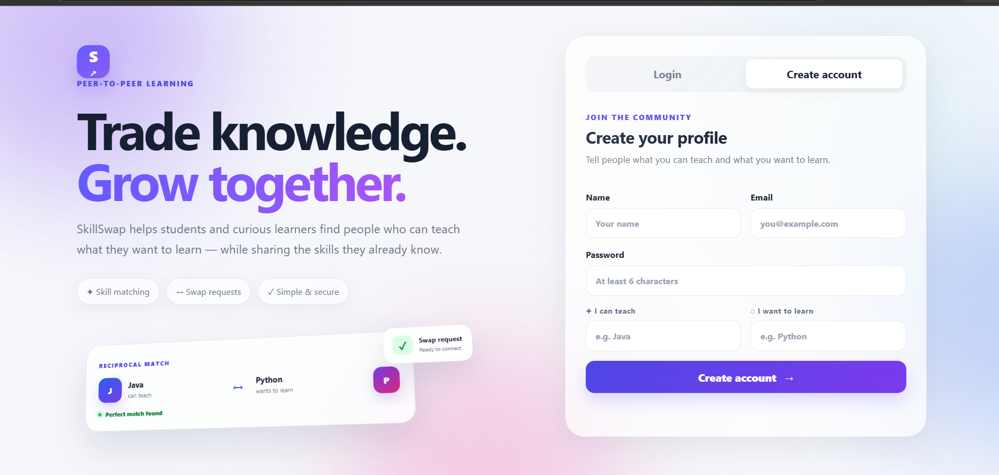
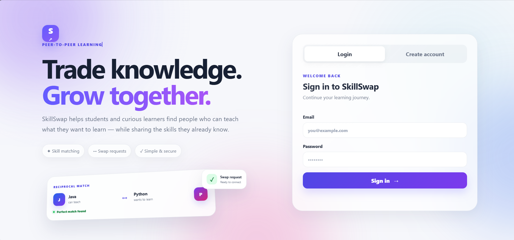
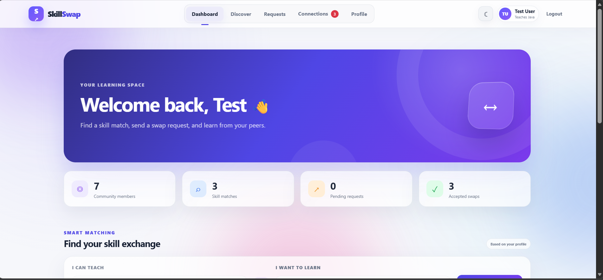
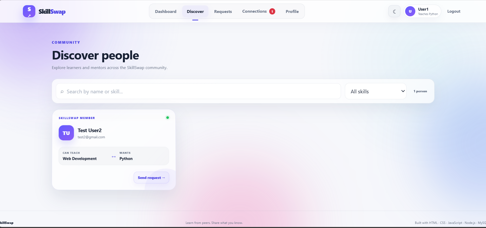
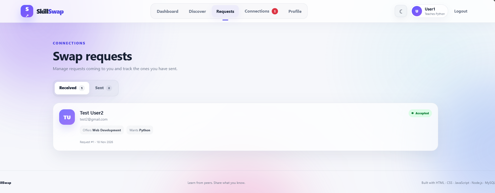
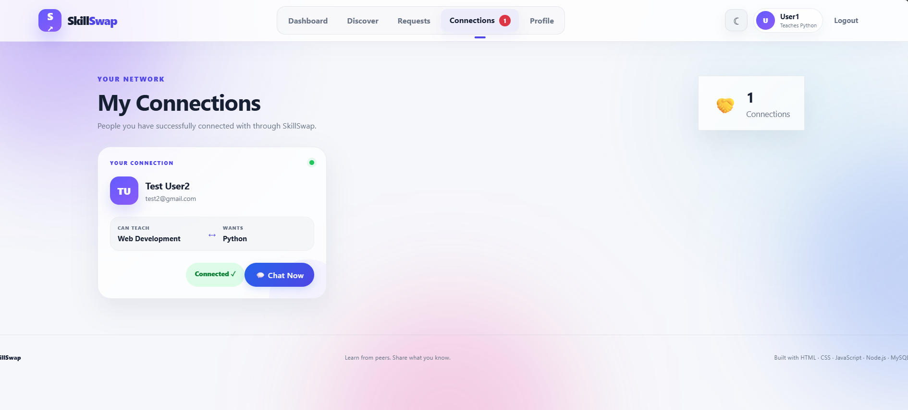
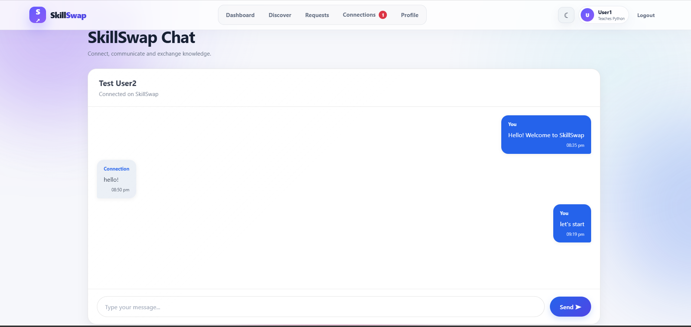

# 🌐 SkillSwap – Peer-to-Peer Skill Exchange Platform

### 🤝 Learn Together. Share Skills. Grow Together.

SkillSwap is a web-based peer-to-peer skill exchange platform that connects people who want to learn new skills with people who can teach them. Users can offer their existing skills, explore other users' skills, send exchange requests, build connections, and communicate through an integrated chat system.

The main objective of SkillSwap is to encourage collaborative learning and make skill development more accessible through mutual knowledge sharing.

---

## 📌 Table of Contents

1. Project Overview
2. Key Features
3. Project Screenshots
4. Technology Stack
5. Project Structure
6. Installation and Setup
7. How SkillSwap Works
8. Main Modules
9. Database Overview
10. Security Features
11. Testing
12. Future Enhancements
13. Project Outcome
14. Author

---

## 🎯 Project Overview

SkillSwap provides a platform where users can exchange knowledge without depending entirely on traditional learning methods.

For example, one user may know Python and want to learn Java, while another user knows Java and wants to learn Python. SkillSwap helps identify this mutual learning opportunity and allows both users to connect.

The system uses rule-based skill matching to identify reciprocal learning opportunities.

---

## ✨ Key Features

### 🔐 1. User Authentication
- User registration and login.
- Secure password hashing using bcrypt.
- Token-based authentication.
- Protected user operations.

### 👤 2. User Profile Management
- Create and update user profiles.
- Add skills offered.
- Add skills wanted.
- Manage personal skill information.

### 🔍 3. Skill Discovery
- Explore other registered users.
- Search for available skills.
- Discover potential learning partners.

### 🧠 4. Skill Matching
- Identifies reciprocal skill exchange opportunities.
- Matches users based on offered and wanted skills.
- Helps users find suitable learning partners.

### 🤝 5. Swap Request Management
- Send skill exchange requests.
- View received and sent requests.
- Accept or reject requests.
- Manage exchange requests.

### 🔗 6. Connections
- View accepted connections.
- Connect with users after request acceptance.
- Access connected users for communication.

### 💬 7. Real-Time-Like Chat
- Send and receive messages.
- View previous messages.
- Automatically refresh messages without manually reloading the page.
- Chat is available between accepted connections.

**Note:** Chat messages are automatically refreshed through periodic polling; WebSocket technology is not used.

### 📊 8. Dashboard
- View community statistics.
- Check available skill matches.
- Monitor pending requests.
- View accepted skill exchanges.

### 🌙 9. Theme Support
- Light mode.
- Dark mode.
- Improved user interface experience.

---

## 📸 Project Screenshots

### 🏠 1. Homepage


### 📝 2. Registration Page


### 🔐 3. Login Page


### 📊 4. Dashboard


### 👤 5. User Profile


### 🔍 6. Skill Discovery


### 🤝 7. Swap Requests


### 🔗 8. Connections


### 💬 9. Chat Interface


---

## 🛠️ Technology Stack

| Technology | Purpose |
|---|---|
| HTML5 | Website structure |
| CSS3 | Styling and responsive design |
| JavaScript | Frontend functionality |
| Node.js | Backend runtime environment |
| Express.js | Backend framework |
| MySQL | Relational database |
| REST API | Communication between frontend and backend |
| bcrypt | Password hashing |
| Git & GitHub | Version control and project hosting |
| Visual Studio Code | Development environment |

---

## 📂 Project Structure

```text
SkillSwap/
│
├── backend/
│   ├── config/
│   │   └── db.js
│   │
│   ├── middleware/
│   │   └── auth.js
│   │
│   ├── routes/
│   │   └── users.js
│   │
│   └── server.js
│
├── database/
│   └── schema.sql
│
├── frontend/
│   ├── css/
│   │   └── style.css
│   │
│   ├── js/
│   │   └── app.js
│   │
│   └── index.html
│
├── screenshots/
│   ├── 01-homepage.png
│   ├── 02-register.png
│   ├── 03-login.png
│   ├── 04-dashboard.png
│   ├── 05-profile.png
│   ├── 06-skill-discovery.png
│   ├── 07-swap-requests.png
│   ├── 08-connections.png
│   └── 09-chat.png
│
├── .env
├── .env.example
├── .gitignore
├── LICENSE
├── package.json
├── package-lock.json
└── README.md
```

---

## ⚙️ Installation and Setup

Follow these steps to run the SkillSwap project locally.

### Prerequisites

Install the following tools:

- Node.js
- MySQL Server
- MySQL Workbench
- Visual Studio Code
- Web Browser

### Step 1: Clone the Repository

```bash
git clone YOUR_GITHUB_REPOSITORY_URL
```

Open the downloaded project folder in Visual Studio Code.

### Step 2: Set Up the Database

1. Open MySQL Workbench.
2. Connect to your MySQL server.
3. Open the `database/schema.sql` file.
4. Execute the SQL script.
5. Verify that the `skill_swap` database and its required tables have been created.

### Step 3: Configure Environment Variables

Create or update the `.env` file according to the variables used by your backend configuration.

Example:

```env
PORT=5000
DB_HOST=localhost
DB_USER=root
DB_PASSWORD=your_mysql_password
DB_NAME=skill_swap
JWT_SECRET=your_secret_key
```

**Important:** These are example variable names. Make sure they match the actual names used in your backend code. Never upload your real `.env` file to GitHub.

### Step 4: Install Backend Dependencies

Open the terminal:

```bash
cd backend
npm install
```

### Step 5: Start the Backend Server

```bash
npm start
```

If your backend uses a different start script, use the command defined in `backend/package.json`.

### Step 6: Open the Application

Open the frontend `index.html` file using your browser or the local development method configured in your project.

If your backend serves the frontend, open:

```text
http://localhost:5000
```

---

## 🔄 How SkillSwap Works

The application follows a simple workflow:

1. **Register:** A new user creates an account.
2. **Login:** The user logs into the platform.
3. **Update Profile:** The user adds skills they can teach and skills they want to learn.
4. **Discover:** The user explores other available users.
5. **Match:** The system identifies reciprocal skill matches.
6. **Send Request:** The user sends a skill exchange request.
7. **Accept Request:** The other user accepts or rejects the request.
8. **Connect:** Accepted users become connections.
9. **Communicate:** Connected users exchange messages through chat.

---

## 🧩 Main Modules

| Module | Description |
|---|---|
| Authentication Module | Handles user registration and login. |
| Profile Module | Manages user information and skills. |
| Skill Discovery Module | Helps users explore available skills. |
| Matching Module | Identifies reciprocal skill matches. |
| Swap Request Module | Handles sending, accepting and rejecting requests. |
| Connection Module | Displays accepted connections. |
| Chat Module | Enables communication between connected users. |
| Dashboard Module | Displays important platform statistics. |

---

## 🗄️ Database Overview

SkillSwap uses **MySQL** as its relational database management system.

The main database tables include:

| Table Name | Purpose |
|---|---|
| users | Stores user details, login information and skills. |
| swap_requests | Stores skill exchange requests and their statuses. |
| chat_messages | Stores messages exchanged between users. |

The database maintains relationships between users, exchange requests and chat messages to support the platform's functionality.

---

## 🔒 Security Features

- Password hashing using bcrypt.
- Token-based authentication.
- Protected backend routes.
- Environment variables for sensitive configuration.
- Database-based user management.
- Access to chat restricted to accepted connections.

---

## 🧪 Testing

The following major functionalities were tested:

- [x] User registration.
- [x] User login.
- [x] Profile update.
- [x] Skill discovery.
- [x] Reciprocal skill matching.
- [x] Sending swap requests.
- [x] Accepting swap requests.
- [x] Rejecting swap requests.
- [x] Viewing connections.
- [x] Sending and receiving chat messages.
- [x] Dashboard statistics.
- [x] Light and dark theme.

---

## 🚀 Future Enhancements

The platform can be improved further by introducing:

- ⭐ User ratings and reviews.
- 📧 Email notifications.
- 🎥 Video-based learning sessions.
- 📚 Structured learning paths.
- 🟢 Online/offline status.
- ⚡ WebSocket-based instant messaging.
- 📱 Improved mobile application support.
- ☁️ Cloud deployment.

---

## 🎓 Project Outcome

SkillSwap demonstrates how web technologies and database management can be combined to develop a collaborative skill exchange platform.

The project provides practical experience in frontend development, backend programming, database connectivity, user authentication, REST API development and application testing.

It encourages peer-to-peer learning by allowing users to share their knowledge and learn new skills through mutual collaboration.

---

## 👩‍💻 Author

**Varsha Singh && Sejal Srivastava**

BCA – Data Science and Artificial Intelligence  
Shri Ramswaroop Memorial University

---

## 📜 License

This project is licensed under the MIT License.

---

### 🌟 SkillSwap – Share Your Skills, Learn Something New!